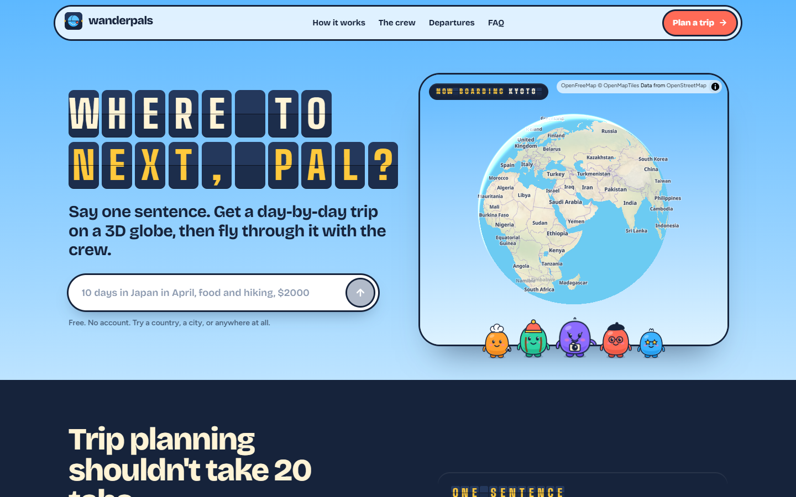
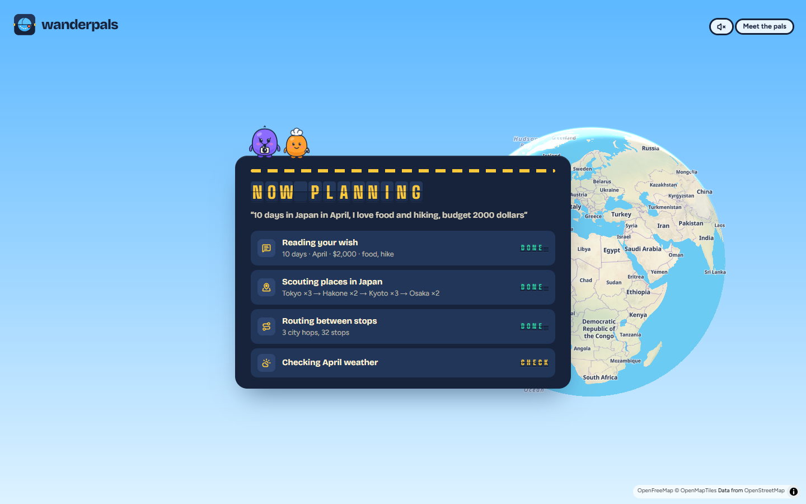
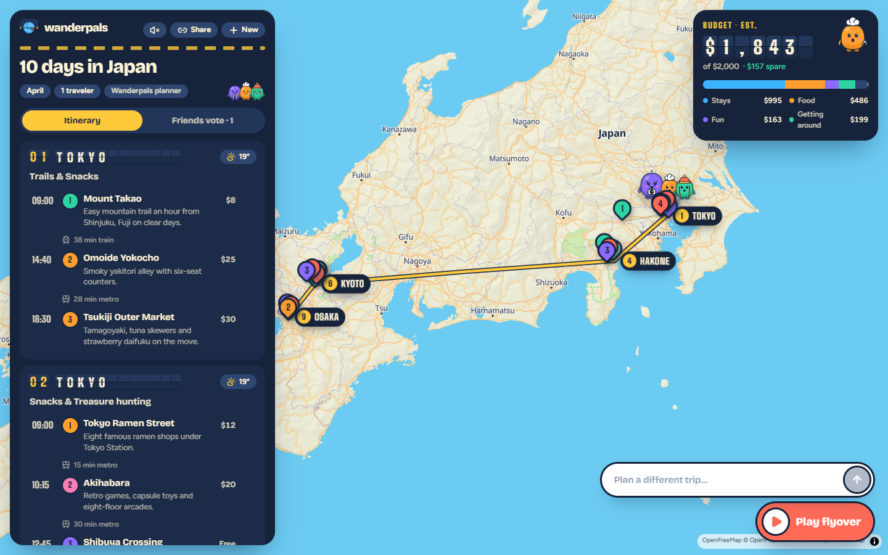
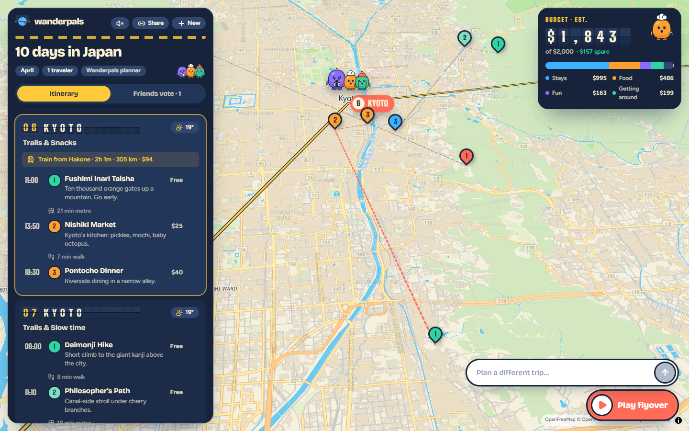
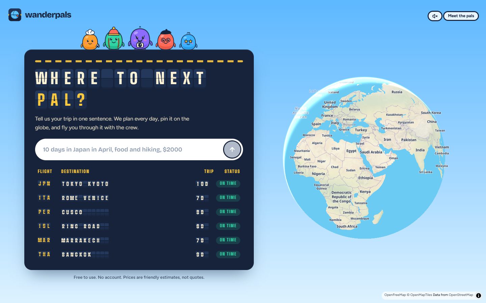
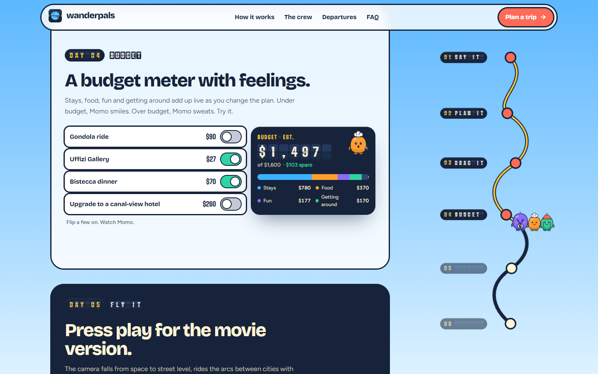
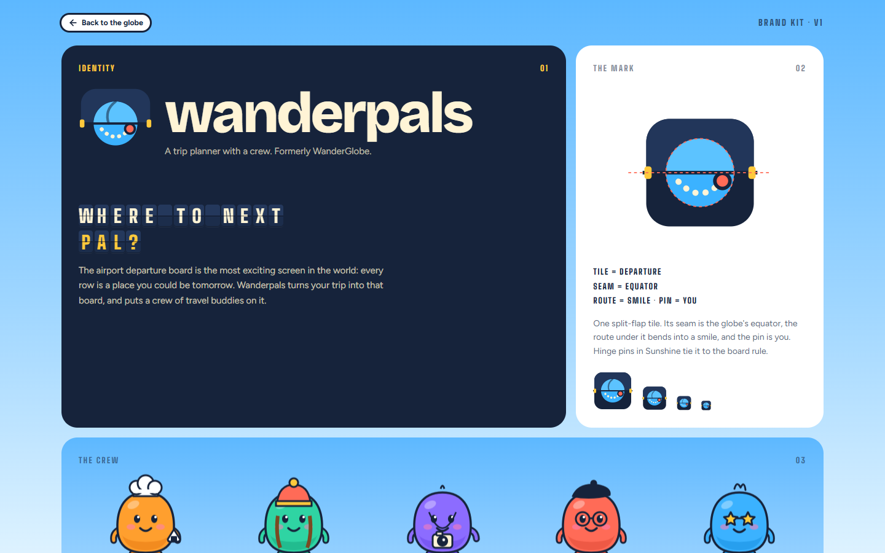
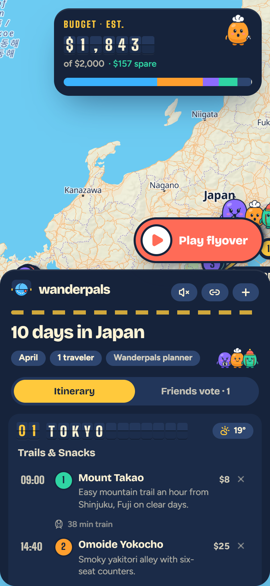

<div align="center">


# Wanderpals

**Where to next, pal?**

Say one sentence about a trip. Wanderpals plans it day by day, pins it on a 3D globe,<br/>
and flies you through it with a crew of little traveler pals.

[**🌍 Live demo**](https://wanderpals-cyan.vercel.app/) · [**▶ Launch video**](docs/media/wanderpals-launch.mp4) · [**Planner**](https://wanderpals-cyan.vercel.app/plan) · [**Brand kit**](https://wanderpals-cyan.vercel.app/brand)


[](docs/media/wanderpals-launch.mp4)

▶ **[Watch the 45-second launch video](docs/media/wanderpals-launch.mp4)** · **[Try it live](https://wanderpals-cyan.vercel.app/)**

</div>

---

## Contents

- [About](#about)
- [Screenshots](#screenshots)
- [Features](#features)
- [Meet the crew](#meet-the-crew)
- [How it works](#how-it-works)
- [Tech stack](#tech-stack)
- [Project structure](#project-structure)
- [Getting started](#getting-started)
- [Environment variables](#environment-variables)
- [Scripts](#scripts)
- [Routes and API](#routes-and-api)
- [Deploy to Vercel](#deploy-to-vercel)
- [Where the data comes from](#where-the-data-comes-from)
- [Privacy](#privacy)
- [Browser support](#browser-support)
- [Accessibility](#accessibility)
- [Design system](#design-system)
- [Troubleshooting](#troubleshooting)
- [Contributing](#contributing)
- [Credits](#credits)

## About

Planning a trip usually means twenty open tabs: a map, a weather site, a spreadsheet for the budget and a group chat arguing about day three. Wanderpals puts all of that on one screen.

You type one sentence, like *"10 days in Japan in April, I love food and hiking, budget 2000 dollars"*. A planner reads it and works through the trip one step at a time, and you watch each step flip onto a split-flap departure board. The finished trip lands on a 3D globe: arcs between cities, a numbered pin for every stop, a live budget meter, and five little traveler pals who cheer when you're under budget and sweat when you're not.

It is free to run. There are no accounts, no database and no paid API keys. Everything comes from free, open data sources, and the whole trip is stored in the share link.

**Live:** https://wanderpals-cyan.vercel.app/

## Screenshots

| Landing page | Planner at work |
|---|---|
|  |  |

| The trip on the globe | A day up close |
|---|---|
|  |  |

| Planner home | Live demos on the landing page |
|---|---|
|  |  |

| Brand kit | On a phone |
|---|---|
|  |  |

### Launch video

[](docs/media/wanderpals-launch.mp4)

A 45-second narrated launch film (1920×1080, 30 fps, with music and sound effects): [`docs/media/wanderpals-launch.mp4`](docs/media/wanderpals-launch.mp4).

## Features

- **One-sentence planning.** Days, month, budget, number of travelers and interests are all read from a single sentence. "A week", "10 days", "$2500", "2000 dollars", "for two" and "in September" all work.
- **A planner you can watch.** Each step (read the wish → scout places → route → typical weather → balance the budget) is streamed from the server and flips onto a split-flap departure board as it happens.
- **3D globe.** A MapLibre globe on free OpenFreeMap tiles, repainted in the Wanderpals palette. Great-circle arcs connect the cities, numbered pins mark every stop, and 3D buildings appear at street level.
- **Board ↔ camera sync.** Scroll the itinerary and the camera follows whichever day is at the top. Tap a city badge or a stop to fly there.
- **Drag to replan.** Drag any pin somewhere new. The spot is named from Wikipedia or OpenStreetMap, the day is re-timed, travel legs are recalculated, and the change in travel time is reported. One click undoes it.
- **A budget meter with feelings.** Stays, food, fun and transit add up live as you edit. Momo smiles under budget and sweats over it. If a plan is too expensive, the planner trims it to fit.
- **Typical weather.** Each day shows the usual highs, lows and rain for the trip month.
- **Cinematic flyover.** A letterboxed tour from space down to street level. The crew rides the arcs, captions flap in, and the browser narrates each day out loud.
- **Friends vote.** Spare ideas go to a vote board. Votes sync between open tabs, and the share link carries the trip plus the votes.
- **Share links.** The whole trip is compressed into the URL hash. Nothing is stored on a server.
- **Saves itself.** Your last trip is kept in the browser and comes back when you return.
- **Anywhere on Earth.** Eight countries have hand-picked places. Any other city or region is planned from OpenStreetMap and Wikipedia.
- **Optional AI scout.** Add two environment variables and a hosted AI model scouts cities and places for any destination. It is off by default and never required.
- **Sound, if you want it.** Synthesized flap clacks and chimes, muted by default.

## Meet the crew

| Pal | Color | Joins your crew when… |
|---|---|---|
| **Momo** · the foodie | tangerine | you mention food, markets or coffee |
| **Pip** · the hiker | mint | you want trails, beaches or slow days |
| **Lux** · the photographer | grape | always. Somebody has to take the photos |
| **Dot** · the history nerd | coral | you mention museums, temples or castles |
| **Zuzu** · the night owl | blue | you want nightlife or shopping |

Every pal has five moods (happy, wow, sweat, sleep and cheer) and reacts to what is happening in the app: planning, flying, going over budget or winning a vote.

## How it works

```
 "10 days in Japan in April, food and hiking, $2000"
                      │
                      ▼
        ┌───────────────────────────┐
        │ parse.ts                  │  days · month · budget · travelers · interests · destination
        └─────────────┬─────────────┘
                      ▼
        ┌───────────────────────────┐
        │ engine.ts  (planTrip)     │  streams each step to the browser as NDJSON
        │  1. choose cities         │  curated data, or Nominatim + Wikipedia
        │  2. plan each day         │  deal places evenly, order by distance, evening stop last
        │  3. route                 │  walk / metro / bus / train / car / flight legs by distance
        │  4. typical weather       │  Open-Meteo archive for the trip month
        │  5. balance the budget    │  trim stays and extras until it fits
        └─────────────┬─────────────┘
                      ▼
              Itinerary JSON  (src/lib/types.ts)
                      │
      ┌───────────────┼────────────────┬──────────────────┐
      ▼               ▼                ▼                  ▼
  GlobeMap      DepartureBoard     BudgetMeter       share link (#t=…)
```

- **The itinerary JSON is the single source of truth.** The globe, the board, the budget and the flyover all render from it, so any planner update or edit re-renders everything.
- **Edits run in the browser.** Dragging a pin calls `/api/place` to name the spot, then `reflow()` re-times the day and rebuilds the travel legs locally.
- **The planner is deterministic.** The same sentence gives the same trip. Live lookups (weather, Wikipedia) have timeouts and fall back gracefully, so a slow API never breaks a plan.
- **The AI scout is optional.** When it's enabled it only suggests cities and places. The built-in engine still does the scheduling, routing and budget math, and falls back to its own planner if the model is unavailable.

## Tech stack

| Area | Choice |
|---|---|
| Framework | [Next.js 16](https://nextjs.org) (App Router, Turbopack, Cache Components) |
| UI | [React 19](https://react.dev), [Tailwind CSS 4](https://tailwindcss.com), [Motion](https://motion.dev), [lucide-react](https://lucide.dev) icons |
| Map | [MapLibre GL 6](https://maplibre.org) with globe projection, [OpenFreeMap](https://openfreemap.org) "liberty" tiles |
| Validation | [Zod 4](https://zod.dev) |
| Data | Open-Meteo, Nominatim (OpenStreetMap), Wikipedia (all free and keyless) |
| Browser APIs | Web Speech (narration), Web Audio (sound), CompressionStream (share links), BroadcastChannel (vote sync), localStorage |
| Optional | `@anthropic-ai/sdk` for the AI scout, only used when its environment variables are set |
| Fonts | Big Shoulders (flap tiles), Bricolage Grotesque (display), Figtree (body) via `next/font` |
| Hosting | [Vercel](https://vercel.com) |

## Project structure

```
wanderpals/
├── docs/
│   ├── media/
│   │   ├── wanderpals-launch.mp4    45-second launch video
│   │   └── wanderpals-poster.jpg    Video poster
│   └── screenshots/                 Images used in this README
├── public/
│   └── maplibre/                    MapLibre worker (copied on install, gitignored)
├── src/
│   ├── app/
│   │   ├── api/
│   │   │   ├── plan/route.ts        POST: streams planner steps + itinerary (NDJSON)
│   │   │   └── place/route.ts       GET: names a dropped pin
│   │   ├── brand/page.tsx           Brand kit: mark, palette, type, crew
│   │   ├── plan/page.tsx            The planner app
│   │   ├── page.tsx                 Landing page
│   │   ├── layout.tsx               Fonts, metadata, root layout
│   │   ├── globals.css              Design tokens, flap tiles, pals, markers
│   │   └── icon.svg                 Favicon / logo mark
│   ├── components/
│   │   ├── TripApp.tsx              App state: plan, edit, undo, share, flyover
│   │   ├── GlobeMap.tsx             MapLibre globe that renders from the itinerary
│   │   ├── DepartureBoard.tsx       Day-by-day itinerary; scroll drives the camera
│   │   ├── PlanLog.tsx              Live planner steps on the flap board
│   │   ├── PromptBar.tsx            The one-sentence input
│   │   ├── BudgetMeter.tsx          Live budget with Momo's mood
│   │   ├── VoteBoard.tsx            Ideas and votes, synced across tabs
│   │   ├── Hero.tsx                 Planner home screen
│   │   ├── FlapText.tsx             Split-flap riffle animation
│   │   ├── Pal.tsx                  The five SVG characters and their moods
│   │   ├── Logo.tsx                 Logo mark and wordmark
│   │   └── landing/
│   │       ├── Scenes.tsx           Hero globe and the scrolling route rail
│   │       └── Demos.tsx            Interactive feature demos on the landing page
│   └── lib/
│       ├── types.ts                 Itinerary schema (single source of truth)
│       ├── planner/
│       │   ├── parse.ts             Sentence → trip request
│       │   ├── engine.ts            planTrip(): the step-by-step planner
│       │   ├── tools.ts             Open-Meteo, Nominatim, Wikipedia lookups
│       │   └── ai-scout.ts          Optional hosted-model scout
│       ├── data/destinations.ts     Curated places for 8 countries + suggested trips
│       ├── itinerary.ts             Re-timing days, legs between stops
│       ├── geo.ts                   Distances, great circles, travel estimates
│       ├── budget.ts                Budget math and formatting
│       ├── share.ts                 Compress / decompress trips for links
│       ├── narration.ts             Flyover narration lines
│       └── sound.ts                 Synthesized clacks and chimes
├── .env.example                     Optional AI scout variables
├── DESIGN.md                        Design system notes
├── PRODUCT.md                       Product brief
├── next.config.ts
├── vercel.json                      Vercel build settings and headers
└── package.json
```

## Getting started

### Prerequisites

- Node.js 20.9 or newer (Node 22+ recommended)
- npm (comes with Node)
- A browser with WebGL 2 (any recent Chrome, Edge, Firefox or Safari)

### Install and run

```bash
git clone https://github.com/Hamzaviour/wanderpals.git
cd wanderpals
npm install     # also copies the MapLibre worker into public/maplibre
npm run dev
```

Open http://localhost:3000. The planner is at http://localhost:3000/plan.

No `.env` file is needed. To try the optional AI scout, see [Environment variables](#environment-variables).

### Try these

Type any of these into the planner, or open the link to plan it straight away:

- `10 days in Japan in April, I love food and hiking, budget 2000 dollars`
- `A week in Italy in June for art, pasta and coastal walks, $2500`
- `6 day road trip in Iceland in September, waterfalls and hot springs, $2200`
- `Morocco for 7 days, desert, souks and mountains, $1200`
- `4 days in Edinburgh, castles and pubs, $900` (no curated data: planned live from OpenStreetMap and Wikipedia)

Example link: [`/plan#q=8 days in Peru, Machu Picchu and markets, budget $1500`](https://wanderpals-cyan.vercel.app/plan#q=8%20days%20in%20Peru%2C%20Machu%20Picchu%20and%20markets%2C%20budget%20%241500)

## Environment variables

Everything works without any variables. The only ones are for the optional AI scout. Copy `.env.example` to `.env.local` and set **both**:

| Variable | Required | Purpose |
|---|---|---|
| `AI_SCOUT_API_KEY` | No | API key for a Messages-API compatible model provider |
| `AI_SCOUT_MODEL` | No | Model id to use |

With both set, the planner shows an extra "Asking the AI scout" step and the trip is tagged "Scouted by AI". With either missing, the built-in engine plans everything.

## Scripts

| Script | What it does |
|---|---|
| `npm run dev` | Start the dev server on port 3000 |
| `npm run build` | Production build |
| `npm start` | Serve the production build |
| `npm run lint` | Run ESLint |
| `npx tsc --noEmit` | Type-check |
| `postinstall` | Runs automatically after `npm install` and copies the MapLibre worker into `public/maplibre` |

## Routes and API

### Pages

| Route | What |
|---|---|
| `/` | Landing page with live demos |
| `/plan` | The planner |
| `/plan#q=<sentence>` | Opens the planner and plans that sentence |
| `/plan#t=<data>` | Opens a shared trip (compressed itinerary + votes) |
| `/brand` | Brand kit: mark, construction, palette, type and the crew |

### `POST /api/plan`

Plans a trip and streams progress as newline-delimited JSON (`application/x-ndjson`).

```bash
curl -N -X POST https://wanderpals-cyan.vercel.app/api/plan \
  -H "Content-Type: application/json" \
  -d '{"prompt":"5 days in Portugal, food and beaches, $1200"}'
```

The request body is `{ "prompt": string }`, trimmed to 400 characters. Each line of the response is one event:

```jsonc
{"type":"step","step":{ ... }}           // a planner step started, updated or finished
{"type":"itinerary","itinerary":{ ... }} // the finished trip (see src/lib/types.ts)
{"type":"error","message":"..."}         // something went wrong
```

### `GET /api/place?lat=<lat>&lng=<lng>`

Names a spot on the map, using the nearest Wikipedia article or an OpenStreetMap reverse lookup.

```bash
curl "https://wanderpals-cyan.vercel.app/api/place?lat=35.0116&lng=135.7681"
```

```json
{ "name": "…", "blurb": "…", "kind": "sight" }
```

It returns `400` if `lat` or `lng` is missing or out of range.

## Deploy to Vercel

[](https://vercel.com/new/clone?repository-url=https%3A%2F%2Fgithub.com%2FHamzaviour%2Fwanderpals)

The repo includes a `vercel.json`, so deploying takes three steps:

1. Push this repo to GitHub (or click the button above).
2. In Vercel, choose **Add New → Project** and import the repo. The Next.js preset is picked up automatically.
3. Click **Deploy**.

Or from the command line:

```bash
npm i -g vercel
vercel          # preview deployment
vercel --prod   # production
```

Notes:

- No environment variables are required.
- The `postinstall` script copies the MapLibre worker into `public/` during the Vercel install step. `vercel.json` caches it for a year.
- Both API routes allow up to 30 seconds (`maxDuration`) for the free weather and Wikipedia lookups.
- `vercel.json` also adds `X-Content-Type-Options: nosniff` and `Referrer-Policy: strict-origin-when-cross-origin` to every response.
- To enable the AI scout in production, add the two variables under **Settings → Environment Variables** and redeploy.

## Where the data comes from

| Data | Source | Key needed |
|---|---|---|
| Curated places for Japan, Italy, Peru, Iceland, Morocco, Portugal, Mexico and Thailand | Hand-picked, in `src/lib/data/destinations.ts` | — |
| Geocoding and reverse lookup for anywhere else | [Nominatim](https://nominatim.org) (OpenStreetMap) | No |
| Nearby places and short descriptions | [Wikipedia](https://www.wikipedia.org) geosearch | No |
| Typical weather for the trip month | [Open-Meteo](https://open-meteo.com) historical archive | No |
| Map tiles | [OpenFreeMap](https://openfreemap.org) | No |

**Limits to know about:**

- Travel times and prices are estimates and are labeled as such everywhere. Check real bookings before you travel.
- "Typical weather" uses last year's daily observations for that month, not a forecast.
- Nominatim and Wikipedia are free community services with fair-use limits. Wanderpals keeps requests small and adds timeouts, but very heavy traffic should use your own instances.

## Privacy

- No accounts, no sign-in, no tracking and no database.
- A trip lives in your browser (localStorage) and in the share link's `#` hash. The part after `#` is never sent to the server.
- The trip sentence is sent to `/api/plan` to be planned and is not stored.
- Narration uses your browser's built-in voices, so no audio leaves your device.

## Browser support

| Feature | Needs |
|---|---|
| Globe | WebGL 2 |
| Share links | `CompressionStream` (Chrome 80+, Firefox 113+, Safari 16.4+) |
| Flyover narration | Web Speech API (voices vary by browser and OS) |
| Vote sync between tabs | `BroadcastChannel` |

The layout adapts to phones and tablets (see the mobile screenshot above).

## Accessibility

- Controls are real buttons and inputs, so they work with the keyboard and show focus rings.
- Flap animations and other CSS motion respect `prefers-reduced-motion`.
- The pals are decorative; every state they show (over budget, planning, voting) is also written in text.
- Sound is muted by default, and narration only plays during the flyover you start yourself.

## Design system

The look is a split-flap departure board on a sunny day. The full notes are in [`DESIGN.md`](DESIGN.md), the product brief is in [`PRODUCT.md`](PRODUCT.md), and the live brand kit is at [`/brand`](https://wanderpals-cyan.vercel.app/brand).

| Token | Hex | Used for |
|---|---|---|
| Ink | `#16233B` | Text, board frames, night sky |
| Flap | `#FFF4D6` | Flap tiles, paper surfaces |
| Sun | `#FFC93C` | Primary accent, highlights |
| Coral | `#FF6B57` | Pins, calls to action, Dot |
| Mint | `#2FD4A3` | Under-budget, success, Pip |
| Grape | `#8C6CFF` | Lux, secondary accent |
| Tangerine | `#FF9F2E` | Momo, food stops |
| Blue | `#3BB2FF` | Zuzu, water, transit |
| Pink | `#FF7EB6` | Small moments of joy |

Typefaces: **Big Shoulders** for flap tiles, **Bricolage Grotesque** for display and **Figtree** for body text.

## Troubleshooting

| Problem | Fix |
|---|---|
| The globe is blank or gray | Make sure `public/maplibre/maplibre-gl-worker.mjs` exists. Run `npm install` again (the `postinstall` step creates it). Also check that WebGL is enabled in your browser. |
| The page loads but nothing is clickable when opened at `127.0.0.1` | Use `http://localhost:3000`, or keep `127.0.0.1` in `allowedDevOrigins` in `next.config.ts`. |
| Weather or places are missing for a custom destination | A free API timed out. The plan still works with fewer details; try again in a moment. |
| No narration during the flyover | Your browser or OS has no speech voices installed, or the tab is muted. |
| The AI scout step never appears | Both `AI_SCOUT_API_KEY` and `AI_SCOUT_MODEL` must be set. Restart the dev server (or redeploy) after adding them. |

## Contributing

Issues and pull requests are welcome.

1. Fork the repo and create a branch: `git checkout -b my-change`.
2. Make your change, then run `npm run lint`, `npx tsc --noEmit` and `npm run build`.
3. Open a pull request that explains what changed and why, with a screenshot for anything visual.

Ideas that would be lovely: more curated countries in `src/lib/data/destinations.ts`, more pals, and translations.

## Credits

- Map data © [OpenStreetMap](https://www.openstreetmap.org/copyright) contributors
- Tiles by [OpenFreeMap](https://openfreemap.org)
- Weather by [Open-Meteo](https://open-meteo.com) (CC BY 4.0)
- Place summaries from [Wikipedia](https://www.wikipedia.org) (CC BY-SA 4.0)
- Launch video music: "Happy Beats / Business Moves" by ende.app
- Launch video sound effects: [Kenney.nl](https://kenney.nl) (CC0)

<div align="center">

Made with sunshine for people who'd rather be traveling.

**[wanderpals-cyan.vercel.app](https://wanderpals-cyan.vercel.app/)**

</div>
